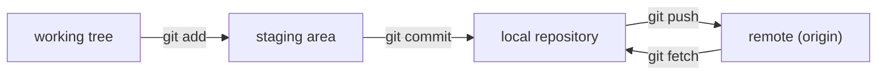

# Tutorial: git version control system

A short, practical course in [git](https://git-scm.com/), the version control
system every engineering project now runs on. No software engineering
background is assumed, and the example you version is a hundred lines of
naval architecture rather than a web application.

Each chapter **is** a runnable notebook, and that notebook is the only copy:
there is no separate written-up version to fall out of date. You work through a
chapter by executing it, one cell at a time, in a throwaway repository you
cannot break.



Nearly every confusing moment in git comes from losing track of which of those
four places your work is in. Chapters 1 to 4 live in the first three; chapter 5
adds the fourth.

## Contents

0. [Setting up](../notebooks/00-setup.ipynb): install git, tell it who you are, meet the sample code
1. [Commits](../notebooks/01-commits.ipynb): snapshots, the staging area, diffs, undoing things
2. [Branches](../notebooks/02-branches.ipynb): one project, several lines of work
3. [Merging](../notebooks/03-merging.ipynb): fast-forwards, merge commits, and conflicts
4. [Rebase](../notebooks/04-rebase.ipynb): replaying commits, tidying history, and the golden rule
5. [Remotes and origin](../notebooks/05-remotes.ipynb): servers, `push`, `fetch`, `pull`, tracking branches
6. [Forks](../notebooks/06-forks.ipynb): contributing to a project you cannot push to
7. [Cherry-pick](../notebooks/07-cherry-pick.ipynb): copying one commit to a release branch
8. [Submodules](../notebooks/08-submodules.ipynb): one repository pinned inside another
9. [Cheat sheet](09-cheat-sheet.md): every command on one page, and how to get unstuck

The first nine are notebooks; GitHub renders them in the browser, and you can
also download them and run them. The cheat sheet is an ordinary page.

## The sample code

One module, `hydrostatics.py`, which computes the immersed volume of a
box-shaped barge and the mass of water it pushes aside, and a file of plain
`assert` checks beside it:

```python
RHO = 1025.0  # kg/m^3, sea water


def volume(length, beam, draft):
    """Immersed volume of the hull, in m^3."""
    return length * beam * draft


def displacement(length, beam, draft):
    """Mass of the water the hull pushes aside, in kg."""
    return RHO * volume(length, beam, draft)
```

It is small on purpose. Every change you make to it should be readable as a
one-screen diff, because reading diffs is most of what using git well consists
of. The notebooks write it themselves and grow it one
commit at a time — a block coefficient, buoyancy, tonnes per centimetre, the
Froude number — and each addition is a few lines you can read as a diff.

## Running the notebooks

The notebooks are in `notebooks/`, one per chapter. They need
git and Python 3.12 or newer with Jupyter, and run the same on Windows, macOS
and Linux:

```bash
pip install jupyterlab
jupyter lab notebooks/00-setup.ipynb
```

A cell starting with `!` runs a shell command, so `!git status` in a notebook is
exactly the `git status` you would type in a terminal. Nothing in this course is
notebook-specific. Each notebook works in its own throwaway directory under
`~/git-course/`, wiped and recreated by the first cell, so you can re-run any
chapter from the top as often as you like.

Start with [0. Setting up](../notebooks/00-setup.ipynb).
